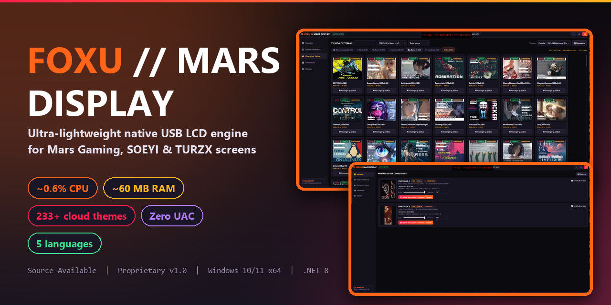
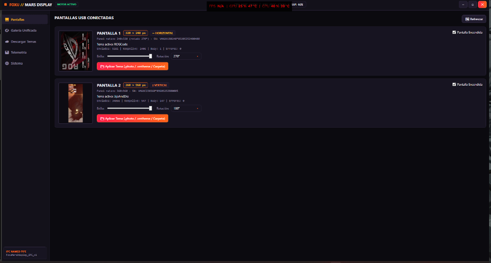
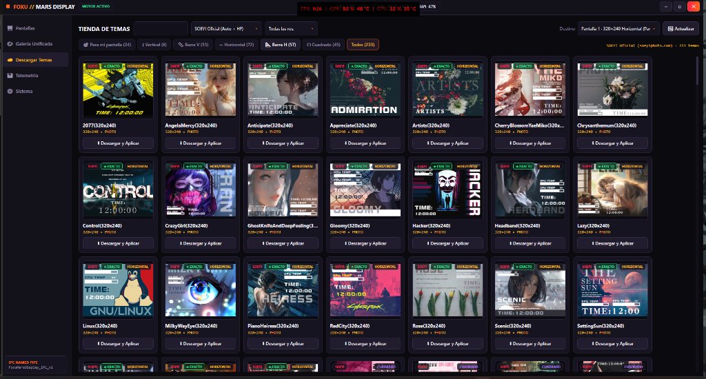
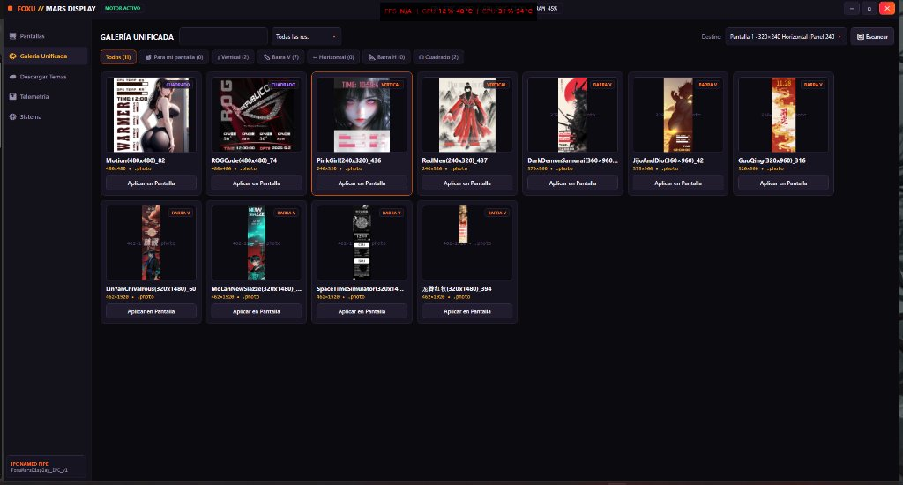
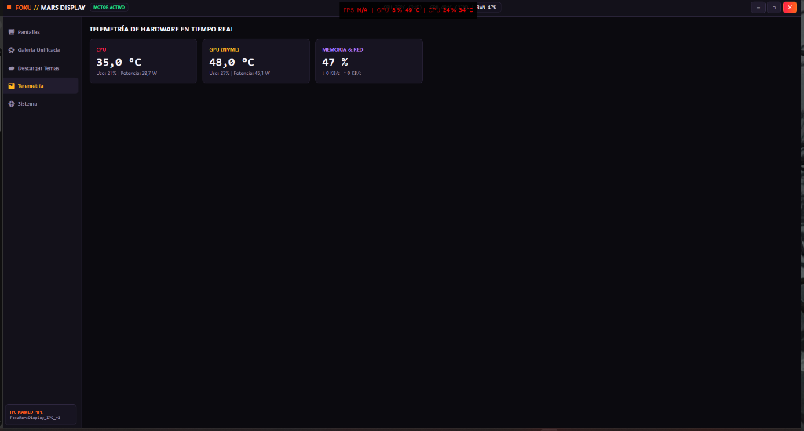

<p align="center">
  
</p>

# FoxuMarsDisplay — Source-Available SOEYI Alternative for Mars Gaming VMAX & USB LCD PC Case Screens

🌐 **Language:** **English** | [Español](README_ES.md)

[](https://github.com/oscarlosu-lab/FoxuMarsDisplay/releases/latest)
[](https://github.com/oscarlosu-lab/FoxuMarsDisplay/releases)
[](LICENSE)
[](#download--install)
[](#build--test-from-source)
[](#key-features)
[](#key-features)
[](https://ko-fi.com/oscarlosu)

> **FoxuMarsDisplay v2.1.1** is a free for personal use, source-available, ultra-lightweight Windows engine that drives **Mars Gaming VMAX**, **SOEYI**, **MacroSilicon MS912C / MS9132**, **TURZX / Turing (Serial & WinUSB)**, **ArtInChip**, **Thermalright / ChiZhu / MiraBox**, and an expanded USB display catalog — with a built-in **cloud theme store (`328+` curated themes in `catalog_v2.json`)**, **native MP4 video backgrounds**, **WASAPI 16-band audio FFT**, **LRCLIB synced lyrics with ms offset**, **manual weather city selector**, **automatic night brightness**, **local Web/REST remote control**, **integrated `FOXU // STUDIO` WYSIWYG rich-text Theme Editor (live font preview, B/I/U/S/Shadow, alignment, color palette dropdown & proportional canvas scaling)**, **zero-UAC permanent install**, **~0.6 % CPU**, **~60 MB RAM** and **5 auto-detected languages**. No SOEYI software required.

---

## Download & Install

1. Go to the **[latest release](https://github.com/oscarlosu-lab/FoxuMarsDisplay/releases/latest)** and download **`FoxuMarsDisplay_Setup.exe`** (~25 MB).
2. Run it (one UAC prompt, **only for installing**) — it installs permanently to `C:\Program Files\FoxuMarsDisplay`.
3. Autostart is created as a scheduled task, so the app starts with Windows in the tray **without any UAC prompt**.

**Requirements:** Windows 10/11 x64 · [.NET 8 Desktop Runtime (x64)](https://dotnet.microsoft.com/download/dotnet/8.0) · your USB LCD connected (MSDisplay driver, same one SOEYI uses).

> The installer bundles the USB display SDK libraries, so **SOEYI does not need to be installed** (you can uninstall it).

---

## Screenshots

### Connected USB displays — live preview, brightness, rotation, 0 errors


### Built-in cloud theme store — 233+ official themes with live thumbnails


### Unified gallery — filter by orientation and resolution, click to zoom, apply in one click


### Real-time hardware telemetry — CPU, NVIDIA GPU (NVML), RAM and network


---

## Benchmark: FoxuMarsDisplay vs stock SOEYI

| | Stock SOEYI | **FoxuMarsDisplay** |
|---|---|---|
| CPU usage (2 screens, steady state) | ~6–12 % | **~0.6–0.9 %** |
| RAM | ~300–600 MB | **~60 MB** |
| MS9132 screen rebooting every ~8 s (OSD watchdog) | possible | **Fixed — 2 Hz USB keep-alive** |
| UAC prompt on every start | yes | **No (installed scheduled task)** |
| Built-in theme store | no | **233+ official + HuggingFace mirror** |
| Orientation / resolution filters + zoom preview | no | **Yes** |
| UI languages | limited | **5, auto-detected from Windows** |
| Source-available | no | **Yes (Proprietary v1.0)** |

*Measured on a real dual-screen setup (240×320 AIO + 360×960 vertical panel), 0 USB send errors.*

---

## Key Features

- **Zero-allocation SkiaSharp renderer** (BGRA8888) with pre-cropped animated GIF cache and dirty-checking → static themes cost ~0 % CPU.
- **Multi-screen hot-plug**, per-screen brightness (0–100 %), rotation (0° / 90° / 180° / 270°), on/off and Game Mode auto-pause.
- **Unified theme support:** SOEYI `Setting.txt` + Type 0/1 JSON, `.photo` archives (native extraction, no 7-Zip), **TURZX `.smtheme` & `theme.yaml` v2/v3** (radial arc gauges, history line graphs, auto aspect-fit scaling), **Theme Maker** (`DefaultLine`, segmented `GridLine`, `DisplayImages`), PNG sequences, GIFs, and static images.
- **Cloud store:** live catalog from the official SOEYI theme site with automatic HuggingFace fallback, orientation (**Vertical / Horizontal / Square**), resolution and *Compatible with my screen* filters, `★ EXACT` match badge.
- **Click-to-zoom lightbox** for full-resolution previews.
- **Hardware sensors:** NVIDIA NVML (temp, usage, power, core/VRAM clocks, VRAM GB, fan %), LibreHardwareMonitor (PawnIO) with ACPI fallback, DriveInfo disk usage/free GB, and network throughput. Optional 1-click admin mode for CPU temperature sensors.
- **5 languages** auto-detected from Windows: Español, English, Français, Deutsch, Português (switchable in *System*).
- **System tray** with automatic thumbnail RAM trim on minimize, single instance, and Named Pipe IPC (`FoxuMarsDisplay_IPC_v1`).

## Supported Hardware & Resolutions

| Chip / device | Typical products | Resolutions |
|---|---|---|
| MacroSilicon **MS912C / MS9132** (`VID_345F&PID_9132`) | Mars Gaming VMAX cases, SOEYI AIO / vertical panels | 240×320, 320×240, 360×960, 480×480 |
| **AIC** USB display | AIC-based panels | 480×480 and others |
| Themes also available for | 320×1480, 960×360, 1024×600, 1920×462 … | filtered automatically |

## Ecosystem

Create and edit themes with **[SnakeMarsTheme](https://github.com/Snakefoxu/marsmakertheme)** (Theme Studio). It talks to FoxuMarsDisplay through the local Named Pipe `FoxuMarsDisplay_IPC_v1` to push themes live to your screens.

## Roadmap

See **[ROADMAP.md](ROADMAP.md)** and **[TURZX compatibility plan](docs/TURZX_COMPATIBILITY_PLAN.md)**. Next up:
1. Native TURZX themes + USB-serial panels.
2. Full Theme Maker compatibility and a next-gen integrated theme creator.
3. Video wallpapers (MP4/WebM), per-screen slideshow UI, and CI/CD.

## Build & Test from Source

```powershell
dotnet build FoxuMarsDisplay.slnx -c Release
dotnet test tests/FoxuMarsDisplay.Core.Tests/FoxuMarsDisplay.Core.Tests.csproj -c Release
.\scripts\Build-Installer.ps1   # produces dist\FoxuMarsDisplay_Setup.exe
```

The native USB SDK libraries are not redistributed in this repository; place `MSDISPLAYSDKWRRAPER.dll` and `AicUsbDisplay.dll` (x64) in `vendor/native/x64/` before building the installer.

## FAQ & Troubleshooting

**My MS9132 screen reboots / shows the OSD every few seconds.** Fixed in FoxuMarsDisplay with a 2 Hz keep-alive that does not cost render CPU.

**Can I use it without SOEYI installed?** Yes. `.photo` themes are extracted natively and the USB libraries are bundled in the installer.

**Does it ask for administrator rights every time?** No. Only the installer asks once. CPU temperature on some systems needs the optional *Admin (PawnIO)* button.

**Vertical 360×960 orientation:** Since `v1.0.1`, `VMAXC` vertical panels are automatically calibrated (`+180°` hardware offset) with upright live previews in *Displays*, while still allowing manual `0° / 90° / 180° / 270°` overrides.

## Support the project

If this saved you from the stock software, consider supporting development:

[](https://ko-fi.com/oscarlosu)

## License & Disclaimer

[FoxuMarsDisplay Proprietary License v1.0](LICENSE) — Source-available, free for personal non-commercial use. **NOT Open Source.** Not affiliated with Mars Gaming, SOEYI, MacroSilicon or TURZX; all trademarks belong to their owners. Official themes are downloaded from their public source at the user's request.
