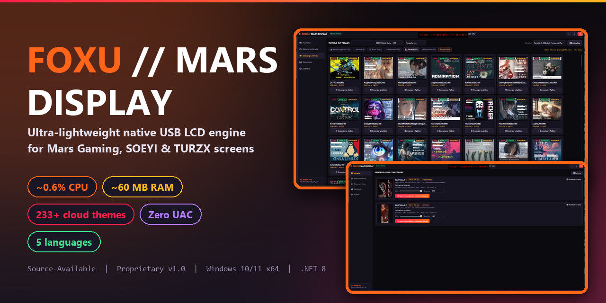
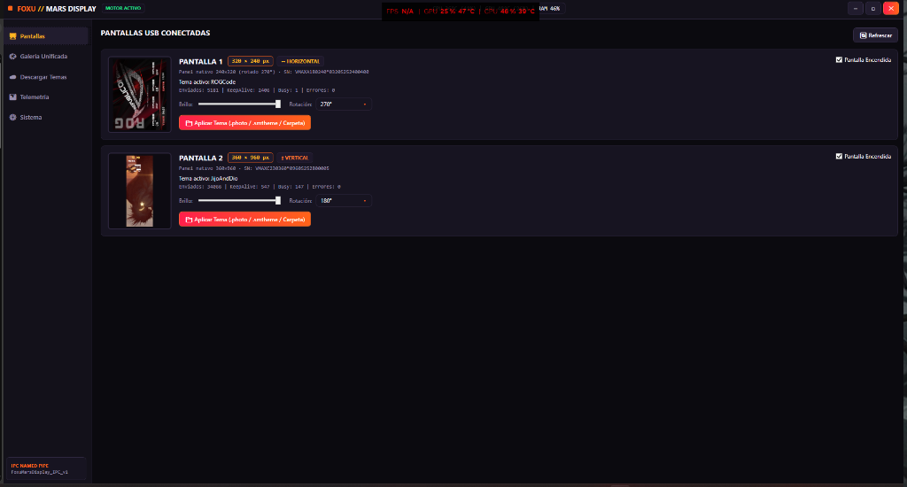
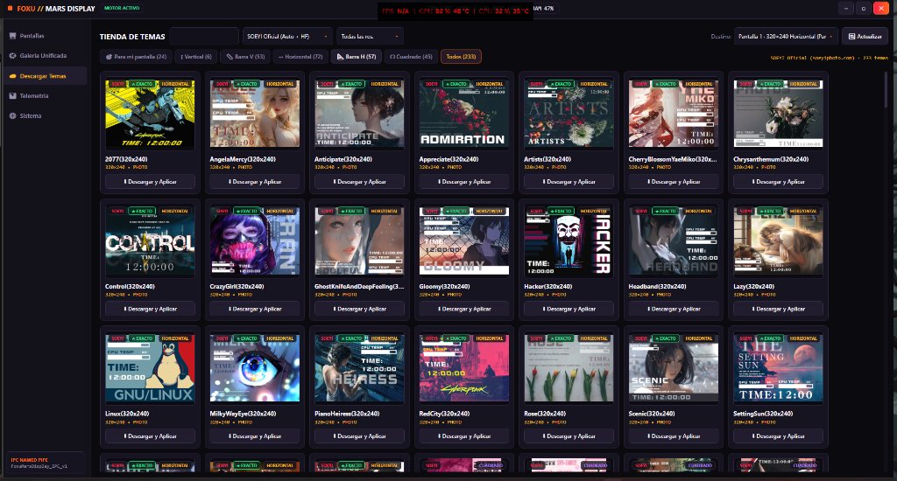
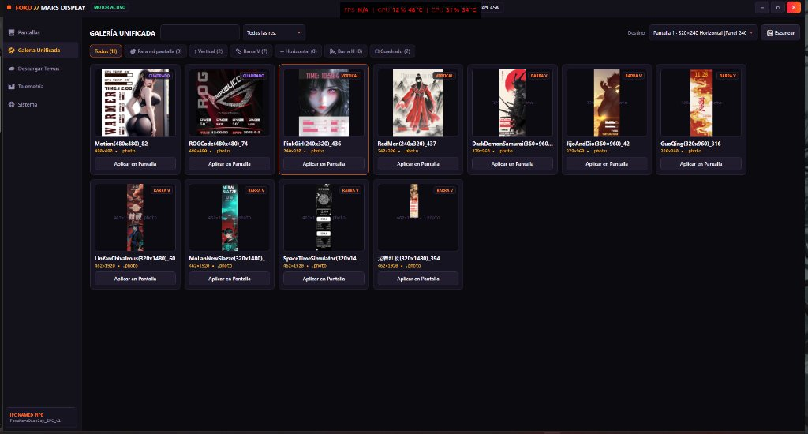
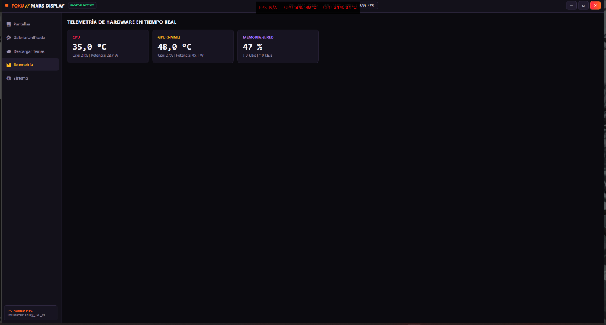

<p align="center">
  
</p>

# FoxuMarsDisplay — Alternativa Source-Available a SOEYI para Mars Gaming VMAX y Pantallas LCD USB de Caja de PC

🌐 **Idioma:** [English](README.md) | **Español**

[](https://github.com/oscarlosu-lab/FoxuMarsDisplay/releases/latest)
[](https://github.com/oscarlosu-lab/FoxuMarsDisplay/releases)
[](LICENSE)
[](#descarga-e-instalación)
[](#compilar-y-probar-desde-el-código)
[](#características)
[](#características)
[](https://ko-fi.com/oscarlosu)

> **FoxuMarsDisplay v2.1.1** es un motor gratuito para uso personal, source-available y ultra ligero para Windows que controla **Mars Gaming VMAX**, **SOEYI**, **MacroSilicon MS912C / MS9132**, **TURZX / Turing (Serie y WinUSB)**, **ArtInChip**, **Thermalright / ChiZhu / MiraBox** y un catálogo USB ampliado — con **tienda de temas integrada (`328+` temas curados en `catalog_v2.json`)**, **vídeos `.mp4` nativos**, **espectro de audio WASAPI FFT de 16 bandas**, **letras sincronizadas LRCLIB con ajuste en ms**, **selector manual de ciudad meteorológica**, **brillo nocturno automático**, **control remoto Web/REST local**, **editor visual WYSIWYG `FOXU // STUDIO` (vista previa de fuentes, B/I/U/S/Sombra, alineación, paleta de colores desplegable y escalado proporcional)**, **instalación permanente sin UAC**, **~0,6 % de CPU**, **~60 MB de RAM** y **5 idiomas autodetectados**. No necesitas el software de SOEYI.

---

## Descarga e instalación

1. Ve a la **[última release](https://github.com/oscarlosu-lab/FoxuMarsDisplay/releases/latest)** y descarga **`FoxuMarsDisplay_Setup.exe`** (~25 MB).
2. Ejecútalo (un aviso UAC, **solo para instalar**): se instala de forma permanente en `C:\Program Files\FoxuMarsDisplay`.
3. El autoarranque es una tarea programada: la app inicia con Windows en la bandeja **sin ningún aviso de UAC**.

**Requisitos:** Windows 10/11 x64 · [.NET 8 Desktop Runtime (x64)](https://dotnet.microsoft.com/download/dotnet/8.0) · pantalla USB LCD conectada (driver MSDisplay, el mismo que usa SOEYI).

> El instalador incluye las librerías del SDK USB, así que **no hace falta tener SOEYI instalado** (puedes desinstalarlo).

---

## Capturas

### Pantallas USB conectadas — vista previa en vivo, brillo, rotación, 0 errores


### Tienda de temas integrada — 233+ temas oficiales con miniaturas en vivo


### Galería unificada — filtra por orientación y resolución, zoom con un clic, aplica al instante


### Telemetría de hardware en tiempo real — CPU, GPU NVIDIA (NVML), RAM y red


---

## Comparativa: FoxuMarsDisplay vs SOEYI original

| | SOEYI original | **FoxuMarsDisplay** |
|---|---|---|
| CPU (2 pantallas, estable) | ~6–12 % | **~0,6–0,9 %** |
| RAM | ~300–600 MB | **~60 MB** |
| Pantalla MS9132 que se reinicia cada ~8 s (watchdog OSD) | posible | **Corregido — keep-alive USB a 2 Hz** |
| UAC en cada arranque | sí | **No (tarea programada instalada)** |
| Tienda de temas integrada | no | **233+ oficiales + espejo HuggingFace** |
| Filtros de orientación / resolución y zoom | no | **Sí** |
| Idiomas | limitados | **5, autodetectados del sistema** |
| Código visible (Source-Available) | no | **Sí (Propietaria v1.0)** |

*Medido en un equipo real con dos pantallas (AIO 240×320 + panel vertical 360×960), 0 errores de envío USB.*

---

## Características

- **Renderizador SkiaSharp sin asignaciones** (BGRA8888) con caché de GIF animados y detección de cambios → los temas estáticos cuestan ~0 % de CPU.
- **Multi-pantalla con hot-plug**, brillo por pantalla (0–100 %), rotación (0° / 90° / 180° / 270°), encendido/apagado y pausa automática en modo juego.
- **Soporte unificado:** `Setting.txt` + JSON Tipo 0/1 de SOEYI, paquetes `.photo` (extracción nativa, sin 7-Zip), **TURZX `.smtheme` y `theme.yaml` v2/v3** (medidores radiales, gráficas de historial, escalado automático *aspect-fit*), **Theme Maker** (`DefaultLine`, `GridLine` segmentado, `DisplayImages`), secuencias PNG, GIF e imágenes.
- **Tienda en la nube:** catálogo en vivo del sitio oficial de temas SOEYI con respaldo automático en HuggingFace, filtros de orientación (**Vertical / Horizontal / Cuadrado**), resolución y *Compatible con mi pantalla*, insignia `★ EXACTO`.
- **Vista previa ampliable** a resolución completa con un clic.
- **Sensores:** NVIDIA NVML (temp, uso, consumo, relojes GPU/VRAM, VRAM GB, fan %), LibreHardwareMonitor (PawnIO) con respaldo ACPI, disco (uso/libre GB) y tráfico de red. Modo administrador opcional con un clic para la temperatura de CPU.
- **5 idiomas** autodetectados desde Windows: Español, English, Français, Deutsch, Português (cambiable en *Sistema*).
- **Bandeja del sistema** con liberación automática de RAM de miniaturas al minimizar, instancia única e IPC por Named Pipe (`FoxuMarsDisplay_IPC_v1`).

## Hardware y resoluciones compatibles

| Chip / dispositivo | Productos habituales | Resoluciones |
|---|---|---|
| MacroSilicon **MS912C / MS9132** (`VID_345F&PID_9132`) | Cajas Mars Gaming VMAX, paneles AIO / verticales SOEYI | 240×320, 320×240, 360×960, 480×480 |
| Pantallas USB **AIC** | Paneles basados en AIC | 480×480 y otras |
| Temas también disponibles | 320×1480, 960×360, 1024×600, 1920×462 … | filtrado automático |

## Ecosistema

Crea y edita temas con **[SnakeMarsTheme](https://github.com/Snakefoxu/marsmakertheme)** (Theme Studio). Se comunica con FoxuMarsDisplay por el Named Pipe local `FoxuMarsDisplay_IPC_v1` para enviar temas en vivo a tus pantallas.

## Hoja de ruta

Consulta **[ROADMAP.md](ROADMAP.md)** y el **[plan de compatibilidad TURZX](docs/TURZX_COMPATIBILITY_PLAN.md)**. Próximamente:
1. Temas TURZX nativos + paneles USB-serie.
2. Compatibilidad total con Theme Maker y un creador de temas integrado de nueva generación.
3. Fondos de vídeo (MP4/WebM), UI de carrusel por pantalla y CI/CD.

## Compilar y probar desde el código

```powershell
dotnet build FoxuMarsDisplay.slnx -c Release
dotnet test tests/FoxuMarsDisplay.Core.Tests/FoxuMarsDisplay.Core.Tests.csproj -c Release
.\scripts\Build-Installer.ps1   # genera dist\FoxuMarsDisplay_Setup.exe
```

Las librerías nativas del SDK USB no se redistribuyen en este repositorio; coloca `MSDISPLAYSDKWRRAPER.dll` y `AicUsbDisplay.dll` (x64) en `vendor/native/x64/` antes de generar el instalador.

## Preguntas frecuentes

**Mi pantalla MS9132 se reinicia / muestra el OSD cada pocos segundos.** Corregido en FoxuMarsDisplay con un keep-alive a 2 Hz que no consume CPU de render.

**¿Funciona sin SOEYI instalado?** Sí. Los temas `.photo` se extraen de forma nativa y las librerías USB van en el instalador.

**¿Pide permisos de administrador cada vez?** No. Solo el instalador, una vez. La temperatura de CPU en algunos equipos necesita el botón opcional *Admin (PawnIO)*.

**Orientación vertical 360×960:** Desde `v1.0.1`, los paneles verticales `VMAXC` se calibran automáticamente (`+180°` por hardware) manteniendo la vista previa siempre al derecho en *Pantallas*, con ajuste manual `0° / 90° / 180° / 270°` disponible.

## Apoya el proyecto

Si te ha librado del software original, puedes apoyar el desarrollo:

[](https://ko-fi.com/oscarlosu)

## Licencia y aviso legal

[FoxuMarsDisplay Proprietary License v1.0](LICENSE) — Source-available, gratuito para uso personal no comercial. **NO es Open Source.** Sin afiliación con Mars Gaming, SOEYI, MacroSilicon ni TURZX; todas las marcas pertenecen a sus propietarios. Los temas oficiales se descargan de su fuente pública a petición del usuario.
